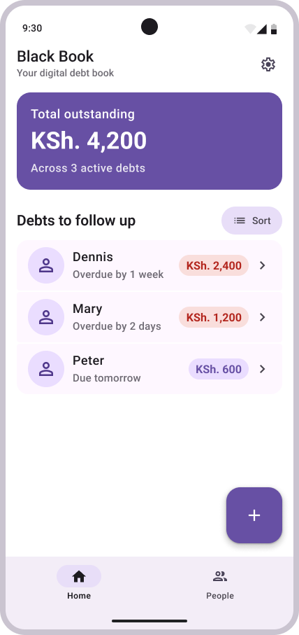
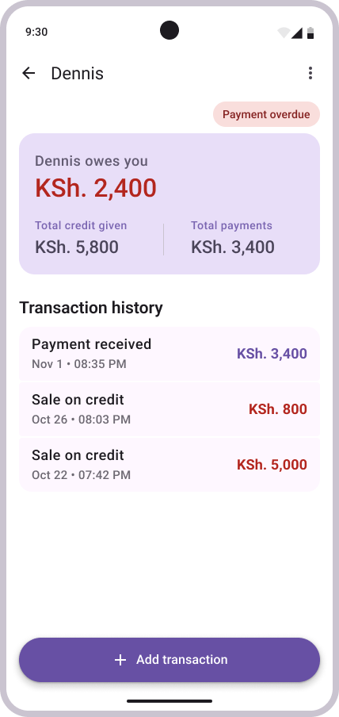

# Black Book – Debt Tracker App

A simple, offline-first Android application for keeping track of money people owe you. Record debts, track partial repayments, and monitor outstanding balances in one place.

Built with **Kotlin, Jetpack Compose, and Material 3**, this project demonstrates modern native Android development practices, clean architecture, and thoughtful UI design.

## 📱 Screenshots

| Home Screen | Debt Details |
|:---:|:---:|
|  |  |

## 🚀 Overview

Keeping track of money lent to different people can quickly become disorganized, especially when repayments happen in installments.

Black Book provides a simple way to manage these transactions. Users can maintain individual debt records, add repayments as they happen, and see exactly how much is still outstanding.

The application emphasizes simplicity, clarity, and an intuitive user experience.

## ✨ Features

- **Offline First:** Manage debt records without requiring an internet connection and logins.
- **Debt Management:** Add and manage individual debt records for different people.
- **Partial Repayments:** Record multiple payments against an existing debt.
- **Outstanding Balance:** Automatically calculate the remaining amount owed after repayments.
- **Debt Overview:** View total outstanding debt and individual debtor balances.
- **Settled Debts:** Separate outstanding debts from fully settled ones.
- **Debt Details:** View the history of debts and repayments for each person.
- **Multiple Currency Support:** Choose the currency used throughout the application, allowing users to track debts and repayments in their preferred currency. Supports all major currencies.

## 🛠️ Tech Stack

- **Language:** Kotlin
- **UI Framework:** Jetpack Compose
- **Design System:** Material 3
- **Architecture:** Modern Android Development (UI, Domain, and Data layers)
- **Data Persistence:** Local database
- **Asynchronous Programming:** Kotlin Coroutines and Flow

## 🏗️ Architecture

The application follows a layered architecture inspired by Modern Android Development (MAD) guidelines.

The codebase separates responsibilities into three main layers:

- **UI Layer:** Responsible for rendering the interface, handling user interactions, and presenting application state using Jetpack Compose.
- **Domain Layer:** Contains business logic and use cases, keeping application rules independent of the UI and data sources.
- **Data Layer:** Responsible for data persistence, retrieval, and providing data to the domain layer.

This separation improves maintainability, testability, and makes the application easier to extend.

## 🎨 Design

The interface is built using Material 3 components and design principles.

Particular attention was given to:

- Clear visual hierarchy.
- Consistent spacing and component styling.
- Meaningful use of color to communicate financial information.
- Simple navigation and interaction patterns.
- Responsive layouts and accessible UI components.

## 📦 Installation

You can install the application directly from Google Play:

**[Download Debt Tracker on Google Play](https://play.google.com/store/apps/details?id=com.machivictordev.blackbook)**

Alternatively, clone this repository and open the project in Android Studio.

```bash
git clone https://github.com/machivictor/blackbook.git
```

Sync Gradle and run the application on an Android device or emulator.

## 🎯 Project Purpose

The project provided an opportunity to explore:

- Native Android application development.
- Kotlin and declarative UI development.
- Application architecture and separation of concerns.
- Local data persistence and offline-first design.
- Implementing configurable application preferences, including currency selection and consistent currency formatting across the application.
- Material 3 and modern Android UI development.
- Building and publishing an application to Google Play.

## 👨‍💻 Developer

**Machi Victor**

I'm passionate about software development, building useful products, and exploring modern technologies to solve everyday problems.

- **GitHub:** [github.com/machivictor](https://github.com/machivictor)
- **LinkedIn:** [linkedin.com/in/victor-mullata](https://www.linkedin.com/in/victor-mullata/)
- **Google Play:** [View the Application](https://play.google.com/store/apps/details?id=com.machivictordev.blackbook)

---

*Built with Kotlin and Jetpack Compose.*